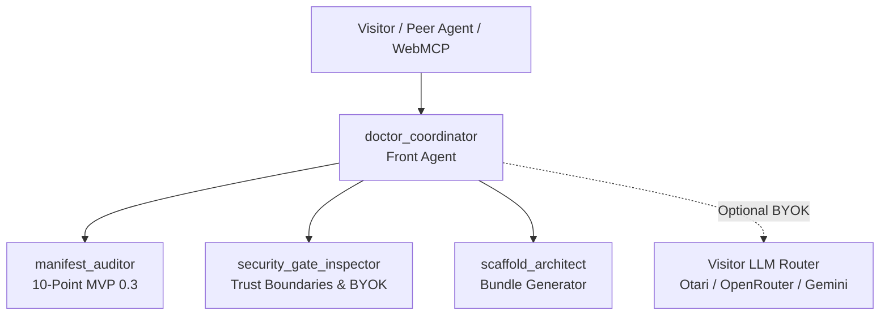

# 🩺 Agentic Web Doctor

**A conforming Open Agentic Website (MVP Profile 0.3) that audits, secures, and scaffolds other Open Agentic Websites — 100% client-side in the browser.**

Built for the [Cognizant Open Agentic Web Challenge](https://cognizant-agenticweb.devpost.com/).

---

## ✨ What It Does

1. **10-Point MVP Profile 0.3 Conformance Auditor (`manifest_auditor`)**:
   - Inspects any CORS-enabled Open Agentic Website URL (including Cognizant's official `Little Oven Pizza` example), pasted `agent-manifest.json`, or runs a **Self-Audit (100/100)** on itself.
   - Verifies `brand`, `networks[]`, portable Neuro SAN `.network.json`, `llm_router` / BYOK, `peer_policy`, `linking`, `deployment`, `sample_queries`, `agent_mcp`, and `actions`.
2. **Trust-Boundary Security Gate (`security_gate_inspector`)**:
   - Checks for hardcoded API key leaks in public JSON artifacts, unsafe wildcard `allowed_peers`, unbounded `max_execution_seconds`, and visitor BYOK sovereignty.
3. **One-Click Compliant Bundle Generator (`scaffold_architect`)**:
   - Generates downloadable, GitHub Pages-ready `agent-manifest.json` and `.network.json` scaffolds for SaaS Docs, E-Commerce, Open Source Projects, and Local Services.
4. **Dual-Engine Browser Runtime & WebMCP**:
   - Runs **100% statically** with zero server-side agent code.
   - Supports **BYOK** (Otari / OpenRouter / OpenAI-compatible endpoints stored strictly in browser `localStorage`) **and** a **Zero-Key Local Deterministic Runtime** so judges and visitors can test every capability immediately without an API key.
   - Registers structured tools via `navigator.modelContext.registerTool` (WebMCP) and `window.agenticWebDoctor`.

---

## 🧩 Multi-Agent Architecture



## 📦 Public Open Agentic Web Artifacts

| File | Purpose |
| :--- | :--- |
| `./agent-manifest.json` | Site manifest (`worldwide-agentic-web-mvp/0.3`), BYOK router & `consent-required` peer policy |
| `./agentic_web_doctor.network.json` | Portable 4-agent Neuro SAN network definition JSON |
| `./agent-mcp.json` | Browser-local WebMCP tool descriptors |
| `./links.json` | Cross-site linking exports (`nsdeploy-link/v1`) |

---

## 🚀 Run Locally (Zero Backend Required)

```bash
# Serve locally on 127.0.0.1 only
python -m http.server 8787 --bind 127.0.0.1
# Open http://127.0.0.1:8787
```

## ✅ Automated Conformance & Security Tests

```bash
python -m unittest discover -s tests -p "verify_*.py" -v
```
